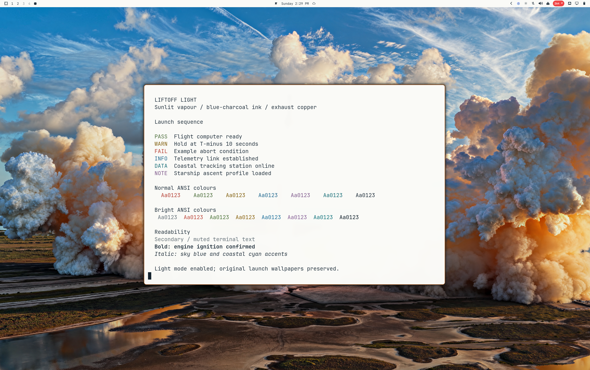

# Liftoff Light

A light variant of [Liftoff](https://github.com/tcballard/omarchy-theme-liftoff), maintained by [Fail-Safe](https://github.com/Fail-Safe), with the near-white brightness of Quattro Lupine. Sunlit vapour surfaces, blue-charcoal text and exhaust-copper focus preserve the original launch-inspired colours. Sky blue, coastal cyan, coral and marsh green are darkened for light-background readability.



## Install

```sh
omarchy theme install https://github.com/Fail-Safe/omarchy-theme-liftoff-light.git
```

On Omarchy 4.0.3-3, the installer names this theme `theme-liftoff-light`. Select it again with:

```sh
omarchy theme set theme-liftoff-light
```

Choose your preferred wallpaper through Omarchy's wallpaper picker. This is a separate variant, not an upstream replacement or an endorsed collaboration. It has not been submitted to a theme marketplace.

## Palette and verification

`colors.toml` declares `mode = "light"`. Supported app configurations are generated by Omarchy's installed templates; no app, shell, font or spacing overrides are included.

- Background: `#FAFAF7`, slightly warm near-white. Relative luminance 0.9541, versus Quattro Lupine's `#fafafa` at 0.9560.
- Foreground: `#263541`, blue-charcoal; 12.04:1 contrast on the background.
- Accent: `#995018`, exhaust copper.
- Selection: `#DCE5EA`, pale sky-grey; generated Alacritty selection text uses `#15232E`.
- Semantic and coloured ANSI text, including bright variants and muted text, each has at least 4.59:1 contrast on the background. Like the stock light-terminal template, ANSI normal black equals the background; that slot is not included in this text-contrast claim.

The local source variant was verified on Omarchy 4.0.3-3 at display scale 1.6: live theme application, shell response, clean Hyprland configuration, horizontal bar, root menu and Alacritty normal/bright ANSI output. The preview is a real desktop capture. Shell, terminal and editor configurations were generated; editor, GTK, lock-screen and other terminal UIs were not exercised.

## Included wallpapers

Four upstream lossless 8K wallpapers are retained unchanged:

- Launchpad view: **8192 × 4608** (`backgrounds/01-liftoff.png`).
- Sunset illustration: **8192 × 4608** (`backgrounds/03-liftoff-sunset.png`).
- Engine-cluster view: **8192 × 5461** (`backgrounds/02-engine-cluster.png`).
- Starship ascent: **8192 × 4667** (`backgrounds/04-starship-ascent.png`).

All four wallpapers were enhanced in two passes; fine detail is AI-reconstructed. The sunset version preserves its painted finish. Tom Ballard gave permission on 11 October 2026 to redistribute the engine-cluster and Starship ascent images in this derivative. Their original image-specific licences have not been independently verified; this permission is not an MIT or public-domain grant over the photographs. See [artwork and attribution](CREDITS.md).

## Credits and licence

[MIT](LICENSE) © 2026 Tom Ballard, covering the theme configuration and documentation. Launchpad photograph: SpaceX; public-domain status confirmed by the upstream repository author, not independently verified. Wallpaper rights are separate; see [artwork and attribution](CREDITS.md). Unofficial community theme, not endorsed by SpaceX or the upstream author.
